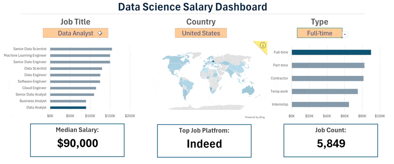
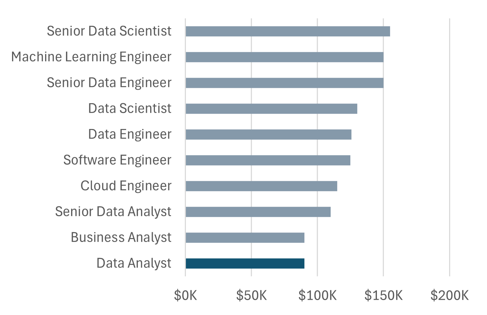
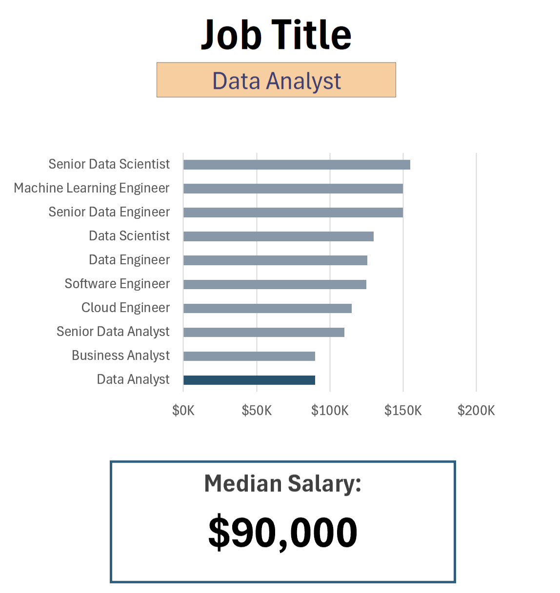
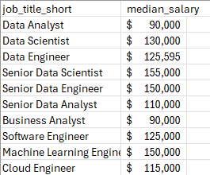
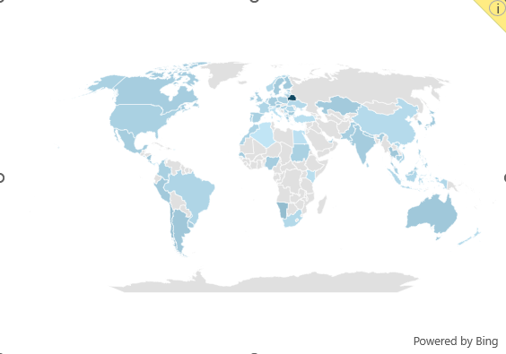
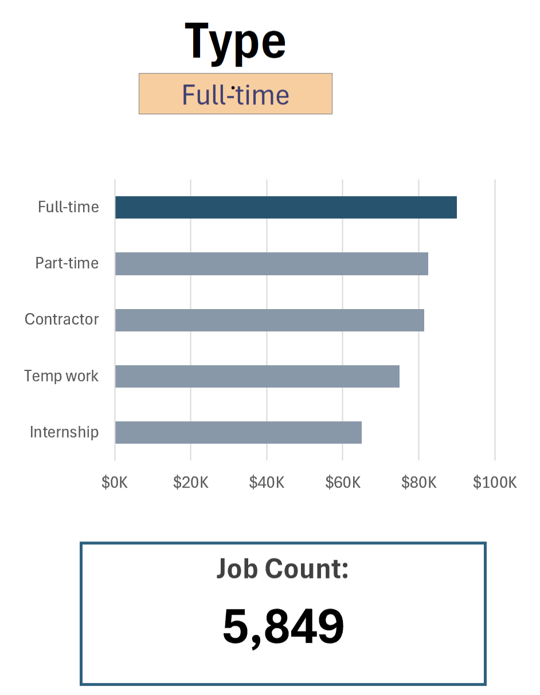
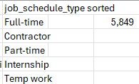
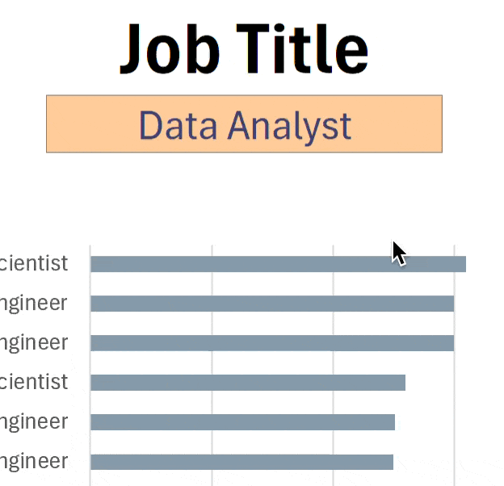

# Salary Dashboard

This data jobs salary dashboard was created to help job seekers investigate salaries for their desired roles, analyze regional distribution, and ensure they are being adequately compensated.

## Final Dashboard Overview

---

## Key Dashboard Components & Visualizations

### 1. Job Title & Salary Analysis
Filter by specific job titles to examine the median pay distribution across top data industry roles.

**Salary Chart View**  

**Median Salary & Selection**  

**Data Source Table**  

---

### 2. Geographic & Country Distribution
Interactive geographic mapping visualizing job listings and market distribution around the world.

**World Map Chart**  

**Interactive Map View**  

---

### 3. Employment Type & Job Volume Breakdown
Analyze compensation and available job volume across Full-Time, Part-Time, Contractor, and Internship roles.

**Employment Type Breakdown**  

**Dropdown Filter**  

**Schedule Count Data**  

**Dropdown View**  

---

## Features & Excel Skills Demonstrated
- **Dynamic Data Validation:** Interactive dropdown lists for seamless filtering by Job Title, Country, and Work Type.
- **Geographic Mapping:** Visualized global market distribution using Bing Maps integration in Excel.
- **Data Summary Tables:** Formatted summary tables calculating median salaries and job posting totals across categories.
