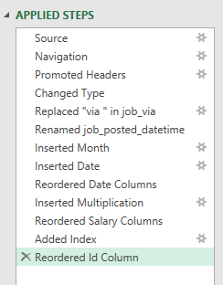
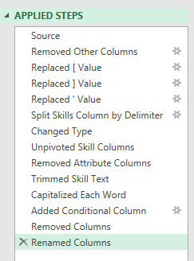
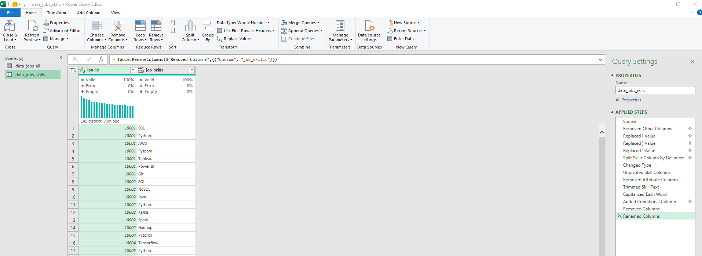

# Project 2 Analysis

## Introduction

As a former job seeker, I’ve always been surprised by the lack of data exploring the most optimal jobs and skills in the data science market. I set out to understand what skills top employers request and how to land more pay.

### Questions to Analyze

To understand the data science job market, I asked the following:

1. **Do more skills get you better pay?**
2. **What’s the salary for data jobs in different regions?**
3. **What are the top skills of data professionals?**
4. **What’s the pay for the top 10 skills?**

### Excel Skills Used

The following Excel skills were utilized for analysis:

- 📊 **Pivot Tables**
- 📈 **Pivot Charts**
- 🧮 **DAX (Data Analysis Expressions)**
- 🔍 **Power Query**
- 💪 **Power Pivot**

### Data Jobs Dataset

The dataset used for this project contains real-world data science job information from 2023. It includes detailed information on:

- 👨‍💼 **Job titles**
- 💰 **Salaries**
- 📍 **Locations**
- 🛠️ **Skills**

---

## 1️⃣ Do more skills get you better pay?

### 🔍 Skill: Power Query (ETL)

#### 📥 Extract
- I first used Power Query to extract the original data (`data_salary_all.xlsx`) and create two queries:
  - 🗃️ First query with all data jobs information.
  - 🔧 Second query listing skills for each job ID.

#### 🔄 Transform
- Transformed each query by changing column types, removing unnecessary columns, cleaning text to eliminate specific words, and trimming excess whitespace.

- 📊 **data_jobs_all**  


- 🛠️ **data_job_skills**  


#### 🔗 Load
- Loaded both transformed queries into the workbook, setting the foundation for analysis.

- 📊 **data_jobs_all**  


- 🛠️ **data_job_skills**  


---

### 📊 Analysis

#### 💡 Insights
- 📈 There is a positive correlation between the number of skills requested in job postings and the median salary, particularly in roles like **Senior Data Engineer** and **Data Scientist**.
- 💼 Roles that require fewer skills, like **Business Analyst**, tend to offer lower salaries, suggesting that more specialized skill sets command higher market value.


#### 🤔 So What
- This trend emphasizes the value of acquiring multiple relevant skills, particularly for individuals aiming for higher-paying roles.

---

## 2️⃣ What’s the salary for data jobs in different regions?

### 🧮 Skills: PivotTables & DAX

#### 📈 Pivot Table
- 🔢 Created a PivotTable using the Data Model built with Power Pivot.
- 📊 Placed `job_title_short` in rows and `salary_year_avg` in values.
- 🧮 Added a new measure to calculate the median salary for United States jobs:

```dax
=CALCULATE(
    MEDIAN(data_jobs_all[salary_year_avg]),
    data_jobs_all[job_country] = "United States"
)
