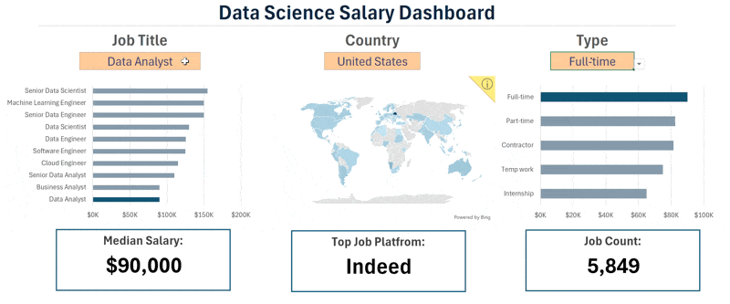
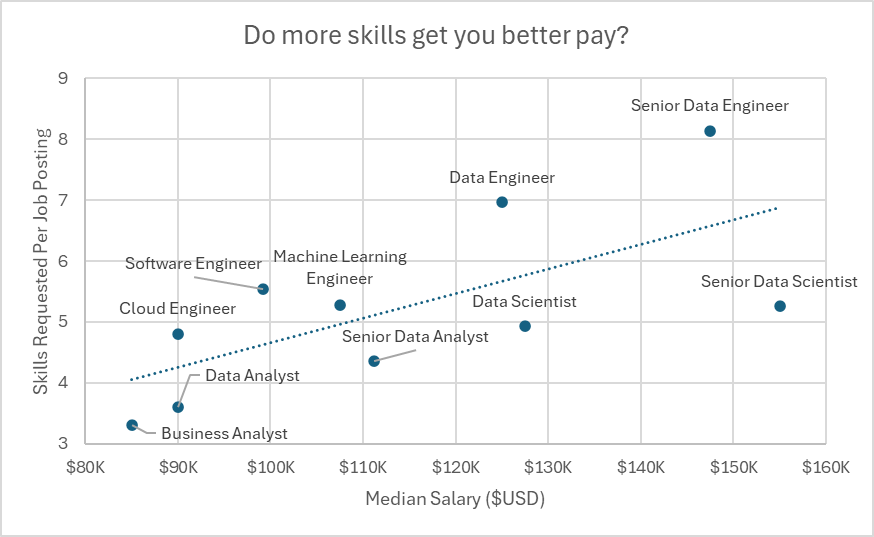

# Excel Data Analytics Portfolio 📊

Welcome to my Excel portfolio! This repository showcases interactive Excel dashboards, data models, and business intelligence projects.

---

## 🚀 Featured Projects

### 002_Sales_Dashboard_2026
* **Overview:** Transforms raw transactional sales data into a clean, dynamic, executive-ready dashboard designed to give stakeholders real-time insights into revenue, profit, product performance, and regional growth.
* **Tools & Features:** Microsoft Excel, XLOOKUP, SUMIFS, Pivot Tables, Pivot Charts, Connected Interactive Slicers, and Dynamic KPI Summary Cards.
* **Key Metrics & Insights:**
  * **KPI Summary Cards:** Tracks Total Sales , Gross Profit , Average Price , and Total Units Sold .
  * **Regional & Category Breakdown:** Evaluates geographical revenue distribution across Europe and identifies top-performing product categories.
  * **Time Trends & Bestsellers:** Analyzes monthly revenue vs. gross profit trends alongside the Top 5 Bestselling products.
* **Files & Resources:**
  * **[Checkout my work here →](./002_Sales_Dashboard_Project/)**
  * 

---
## 001_Data_Jobs_Salary_Dashboard

This data jobs salary dashboard was created to help job seekers investigate salaries for their desired jobs and ensure they are being adequately compensated.

**[Checkout my work here →](./Project_1-Dashboard)**

## 000_Data_Skills_And_Jobs_Analysis

As a former job seeker, I’ve always been surprised by the lack of data exploring the most optimal jobs and skills in the data science market. I set out to understand what skills top employers request and how to land more pay.

**[Checkout my work here →](./Project_2-Analysis)**

