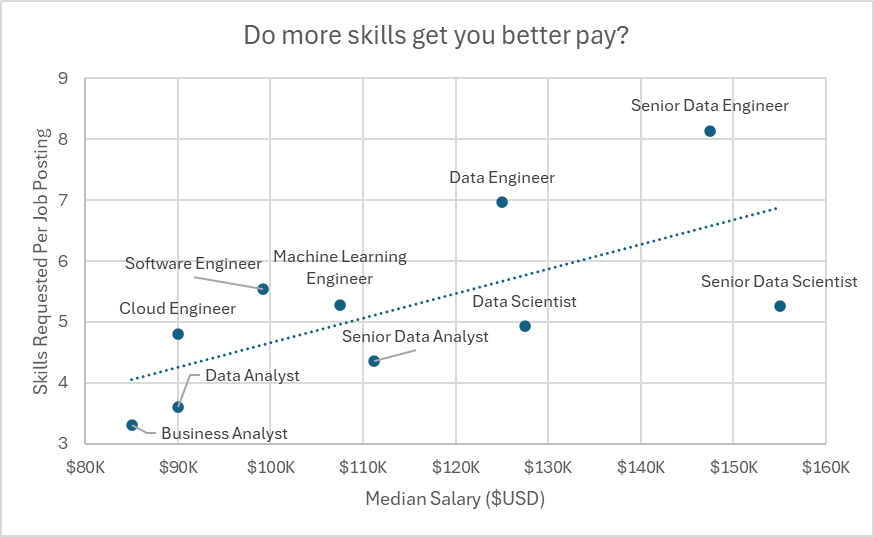

# Excel Project Data Analytics

This repository contains two Excel data analytics projects I completed as part of Luke Barousse’s Excel for Data Analytics course.

## Salary Dashboard

This data jobs salary dashboard was created to help job seekers investigate salaries for their desired jobs and ensure they are being adequately compensated.

**[Checkout my work here →](./Project_1-Dashboard)**

## Salary Analysis

As a former job seeker, I’ve always been surprised by the lack of data exploring the most optimal jobs and skills in the data science market. I set out to understand what skills top employers request and how to land more pay.

**[Checkout my work here →](./Project_2-Analysis)**

