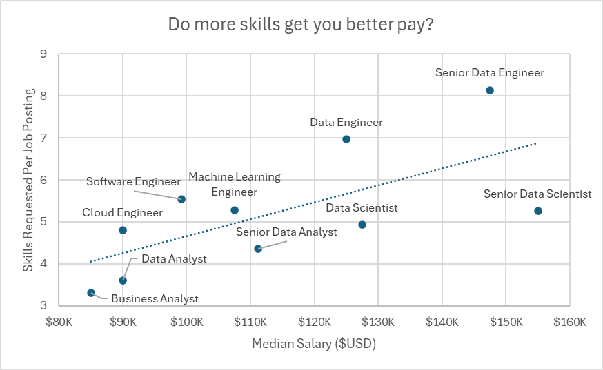

# Excel Data Analytics Portfolio 📊

Welcome to my Excel portfolio! This repository showcases interactive Excel dashboards, data models, and business intelligence projects.

---

## 🚀 Featured Projects

### 003_Clinic_Appointments_Project
- **Overview:** End-to-end healthcare operations and financial analytics dashboard that transforms 5,120 raw clinic records into 5,000 deduplicated, standardized appointments (`2024–2025`), delivering real-time executive insights into revenue growth, department profitability, patient satisfaction, and regional demand.
- **Tools & Features:** Microsoft Excel, Data Cleaning & Feature Engineering (`TRIM`, `CLEAN`, `PROPER`, `SUBSTITUTE`, `LEFT`/`RIGHT`/`SEARCH`), Pivot Tables, Combo & Trendline Pivot Charts, 4 Connected Interactive Slicers (`Visit_Type`, `Department`, `City`, `Payment_Method`), Interactive Date Timeline, Dynamic KPI Summary Cards, and Sheet Protection.
- **Key Metrics & Insights:**
  - **KPI Summary Cards:** Tracks **Total Appointments** (`5,000`), **Total Revenue** (`$249,733`), **Avg Wait Time** (`20.89 min`), **Cancellation Rate** (`13.98%` including no-shows), and **Avg Satisfaction** (`2.89 / 5`).
  - **Department & Service Profitability:** Identifies **General Medicine** (`$72,463.81`) and **Pediatrics** (`$38,435.17`) as top revenue generators, with **Consultations** (`$148,698`) driving nearly 60% of total clinic billing.
  - **Regional Volume & Growth Trends:** Highlights **Cairo** (`2,064` appointments) as the primary operational hub across Egypt, Saudi Arabia, and the UAE, alongside steady upward monthly revenue growth from 2024 through 2025.
  - **Operational & Payment Breakdown:** Monitors appointment completion rates (`4,301` completed vs. `401` cancelled and `298` no-shows) and payment distribution across **Insurance** (`1,803`), **Cash** (`1,648`), and **Card** (`1,549`).
- **Files & Resources:**
  - **[Checkout my work here →](./003_Clinic_Appointments_Project/)**
  - 

 

### 002_Sales_Dashboard_2026
* **Overview:** Transforms raw transactional sales data into a clean, dynamic, executive-ready dashboard designed to give stakeholders real-time insights into revenue, profit, product performance, and regional growth.
* **Tools & Features:** Microsoft Excel, XLOOKUP, SUMIFS, Pivot Tables, Pivot Charts, Connected Interactive Slicers, and Dynamic KPI Summary Cards.
* **Key Metrics & Insights:**
  * **KPI Summary Cards:** Tracks Total Sales , Gross Profit , Average Price , and Total Units Sold .
  * **Regional & Category Breakdown:** Evaluates geographical revenue distribution across Europe and identifies top-performing product categories.
  * **Time Trends & Bestsellers:** Analyzes monthly revenue vs. gross profit trends alongside the Top 5 Bestselling products.
* **Files & Resources:**
  * **[Checkout my work here →](./002_Sales_Dashboard_Project/)**
  * 

---
## 001_Data_Jobs_Salary_Dashboard

This data jobs salary dashboard was created to help job seekers investigate salaries for their desired jobs and ensure they are being adequately compensated.

**[Checkout my work here →](./Project_1-Dashboard)**

## 000_Data_Skills_And_Jobs_Analysis

As a former job seeker, I’ve always been surprised by the lack of data exploring the most optimal jobs and skills in the data science market. I set out to understand what skills top employers request and how to land more pay.

**[Checkout my work here →](./Project_2-Analysis)**

